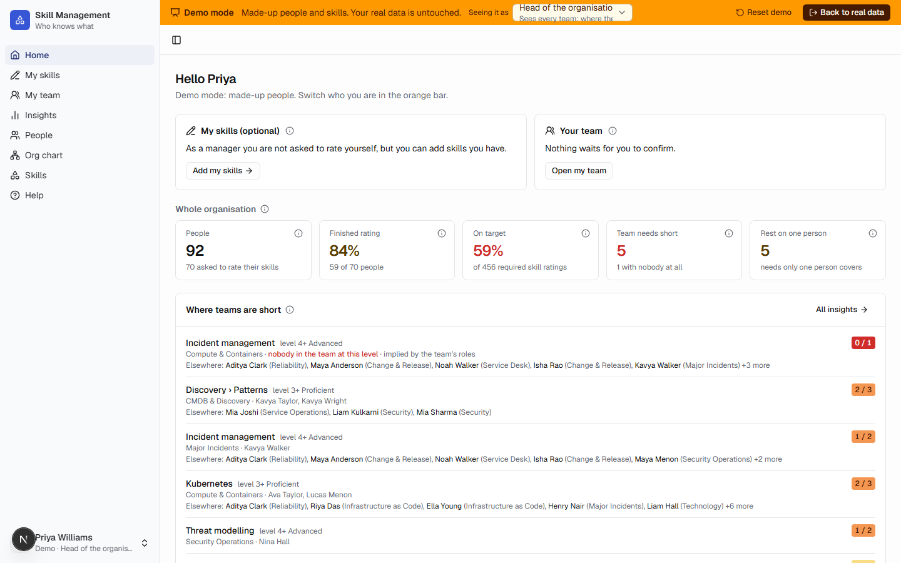
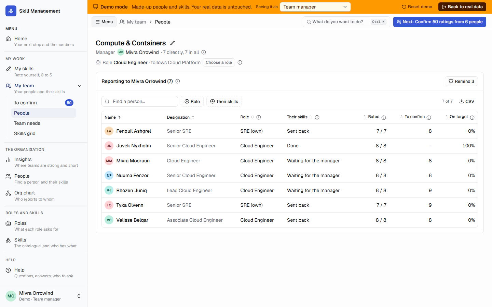
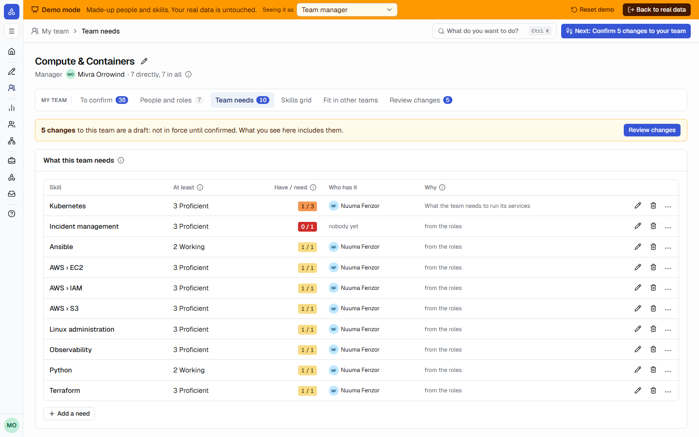
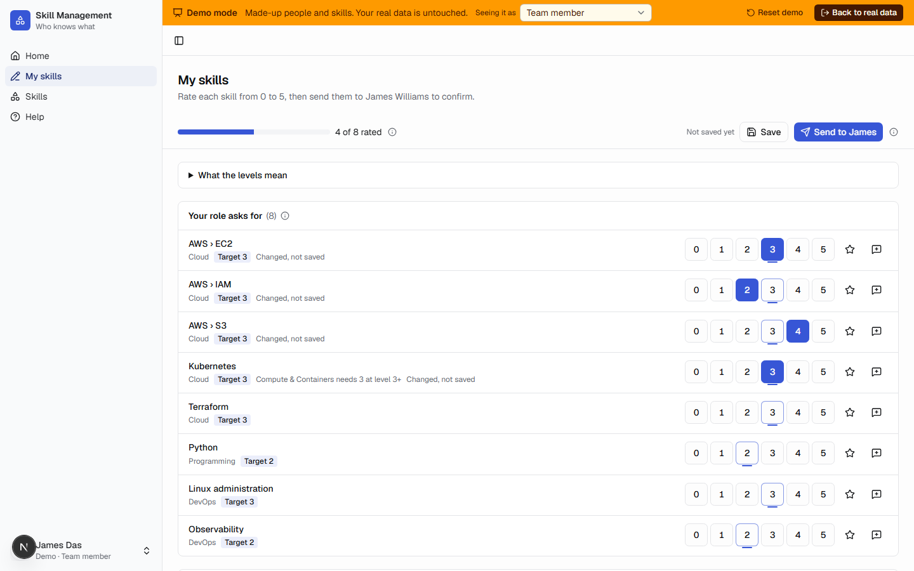
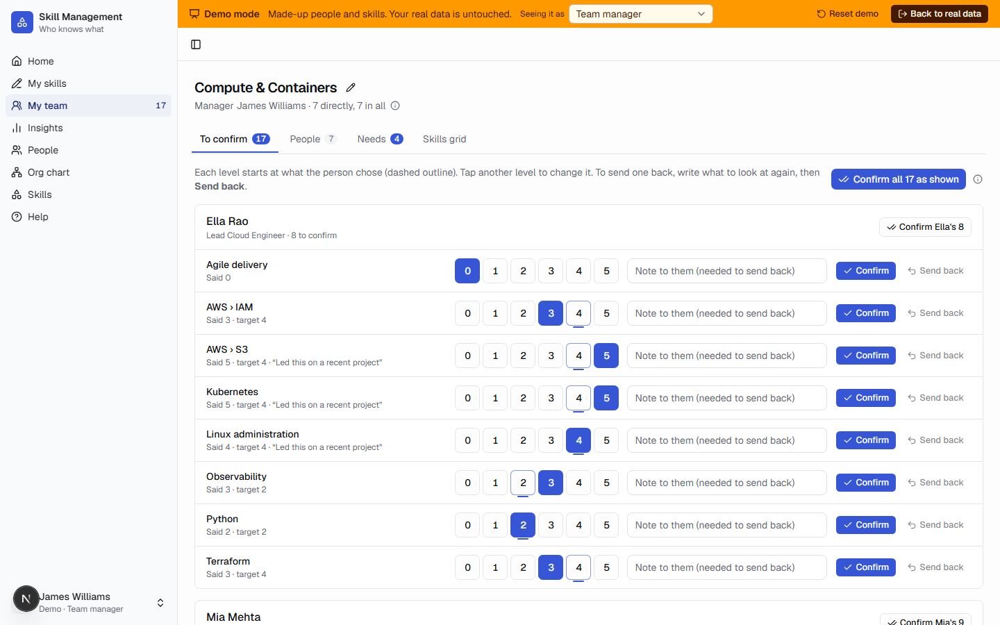
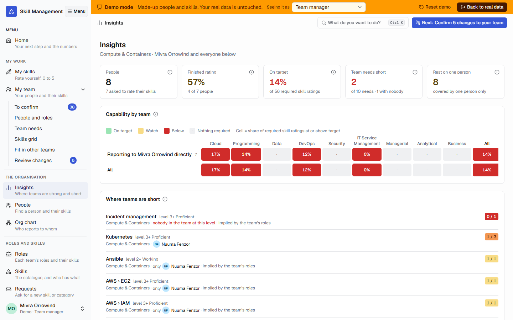
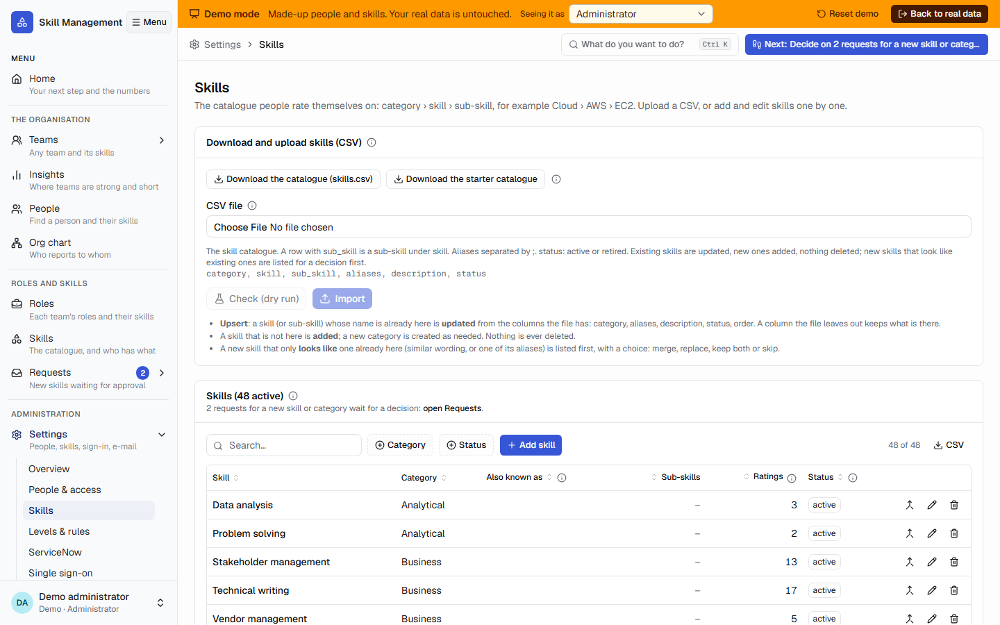

# Skill Management

Who knows what, and what each team needs. People rate their own skills (0 to 5), their manager confirms them, and managers and leaders see what every team can do, where it is short, and who elsewhere in the organisation already has what is missing.

Kept deliberately simple: people, their managers and skills. A team is a manager and everyone below them, straight from the reporting lines in **ServiceNow `sys_user`**. Finding things is meant to need no asking: one **Menu** with a heading per group and a line under every entry saying what is behind it; a page's sections (a team's *To confirm / People / Team needs / Skills grid*, the sections of Settings) are a **sub menu** under its entry; Home lists everything you can do in your own words (*What do you want to do?*), and the box at the top of every page finds it by a word (Ctrl+K). Every number, column and setting has an **(i)** that says what it is, and every name comes with its picture. A **Demo** switch shows a made-up organisation for presentations without touching the real data.



A team's page, with its sections as the sub menu under *My team*; the same sub menu moves to the top of the page when the menu is closed or on a phone:





## Contents

- [What it does](#what-it-does)
- [Demo mode](#demo-mode)
- [Upgrading from version 1](#upgrading-from-version-1)
- [How the numbers work](#how-the-numbers-work)
- [E-mail](#e-mail)
- [People from ServiceNow](#people-from-servicenow)
- [Sign-in and access](#sign-in-and-access)
- [Deploy with Docker](#deploy-with-docker)
- [HTTPS and the certificate](#https-and-the-certificate)
- [Backups and starting over](#backups-and-starting-over)
- [Import and export](#import-and-export)
- [Scale and sizing](#scale-and-sizing)
- [Develop](#develop)
- [Stack and supply chain](#stack-and-supply-chain)
- [Not built yet](#not-built-yet)

## What it does

The menu has eight entries, and each person sees only those that apply to them:

| | Who | What |
|---|---|---|
| **Home** | everyone | **Your next step** (below), then the headline numbers of your team or the organisation |
| **My skills** | everyone with a person record | Rate your skills and send them to your manager |
| **My team** | managers, leaders, administrators | Confirm ratings; the team's **roles** (one section each: who is in it, the skills it asks for); what the team needs; the skills grid; where your people would also fit; **review** of changes not confirmed yet |
| **Insights** | managers, leaders, administrators | Capability by team, where teams are short, strengths, who could strengthen another team |
| **People** · **Org chart** | managers, leaders, administrators | Find anyone, or everyone with a skill at a level; who reports to whom |
| **Roles** | everyone | The roles of a team: who is in each and the skills each asks for. Yours are marked |
| **Skills** | everyone | The catalogue and the 0-5 scale; for managers, who has each skill |
| **Requests** | everyone | Ask for a skill or category that is missing and follow it; **coordinators** approve, send back or refuse |
| **Settings** | administrators | Everything the app needs, one section per item, always listed on the left |

### The next step, for everyone

A **Next: ...** button at the top of every page says the one thing that matters most for you to do now, one click away; Home shows it in full with what comes after it. It is worked out from who you are and what is waiting (`src/lib/next-steps.ts`, `test/next-steps.test.ts`):

| Who | Steps, in order |
|---|---|
| Rating your own skills | look at ratings sent back; rate your skills; rate the ones still missing; send them to your manager |
| Managers | confirm the changes to their team that are still a draft, and the ratings waiting (always first); remind who has not started; make the team's roles or put people in one; say what the team needs, or look at needs that are short |
| Leaders | how many people have finished rating; team needs short across the organisation |
| Administrators | bring people in; load the catalogue; switch on single sign-on and e-mail |
| Coordinators | decide on requests for a new skill or category. Anyone whose request came back: change it and send it again |

With nothing to do the button disappears and Home says so: waiting for your manager, or up to date.

### Roles: each team's own

A **role** is a group inside one team, made by its manager: **who is in it**, and **the skills it asks for**, each with a level. Think of it as a grouping. What a person's roles ask for is what they are asked to rate.

- **A role belongs to its team.** Its name is unique in that team only: two teams can each have an *SRE*, and they are two roles.
- **The manager makes as many as the team needs** (My team › People and roles › *New role*). Each role is a section of the page.
- **People are put in roles by their manager**, never by themselves and never from above: drag a person onto a role (hold Ctrl while dropping to add them to that role *as well*), or tick several people and choose *Add them to a role*.
- **A person can be in several roles.** They are asked for every skill any of their roles asks for, at the highest level asked. Once in a role a person stays in at least one: they can be moved, or taken out of one of several, but not out of their only role.
- **Skills come from the catalogue**, which is the same for every team: *Add skills*, tick them, choose the level. Each shows as a chip; press it to change the level, make it a must-have or a nice-to-have, or remove it. Any skill can be removed, must-haves too.
- **Each role has its own soft colour**, the same wherever the role shows: its section on the team's page, its name beside a person, the Roles page, the lists. A new role takes a colour its team does not use yet; the manager chooses another from the dot beside the role's name, its right-click menu (*Colour*) or the role's own box. There are twelve to choose from and all of them are tints: one lightness, a low strength, laid thinly over the page, so none can come out bright (`src/lib/role-colors.ts`, `test/role-colors.test.ts`). A change of colour is a draft like any other.
- **Who sees the roles** (Roles): those who manage a team (its manager, the managers above, leaders, administrators) see all its roles and who is in each. A team member sees **the roles they are in** and what those ask for: not the team's other roles, and not who else is in a role.

Someone who moves to another manager is in no role there until the new manager gives them one (`src/lib/dataset.ts`). The rules are in `src/lib/team-setup.ts`, tested in `test/team-setup.test.ts`.

### Every change to a team is a draft first

Nothing a manager changes in roles or team needs counts at once. Each change goes into the team's **draft**; the page shows the draft, with what is new marked. **My team › Review changes** lists every difference from what is in force, one line each, with **Take back** on each line; **Confirm** puts it all in force, **Discard all** throws it away. Until then people are asked for what the team had before. A person's own ratings work the same way: *Save* keeps them to yourself, *Send* gives them to the manager.

Settings, a coordinator's decisions and a manager confirming ratings act at once: they are the confirming step themselves.

### Asking for a new skill or category

Skills and categories are the same for everyone, so nobody but an administrator adds to the catalogue directly. A manager (or anyone) **asks** for a skill or a category, from Requests, from a role's *Add skills*, from Team needs or from My skills. A **coordinator** or an administrator then:

- **approves** it (it joins the catalogue at once; the name or its place can be changed first, and the asker sees what was changed),
- **sends it back** with a note, for the asker to change and send again, or
- **says no**, with a reason.

The asker always sees where it is: *waiting with* the coordinators by name, *sent back* with the note, *approved*, or *not approved* with the reason. An administrator makes someone a **Coordinator** in Settings › People & access › Accounts; otherwise a coordinator is who they are (a manager when people report to them). Rules in `src/lib/requests.ts`, tested in `test/requests.test.ts`.

### Right-click anything

Right-click (or press and hold on a phone) a person, a role, a skill, a team need, a request, a line in Review or a row in any list: the menu offers what can be done with exactly that thing, named at the top. The same menu is behind the **⋯** button next to it. An action that is not possible stays in view, greyed, with the reason (`src/components/action-menu.tsx`).

### Where your people would also fit

**My team › Fit in other teams** lists, for each person who reports to a manager, the roles of *other* teams whose skills they already hold at the level asked, with that team and the manager they would be under. A role is listed from **50%** of its skills; an administrator changes that share in Settings › Levels & rules (a whole number from 1 to 100). A person's own page shows the same. It shows capability only: whether anyone moves is a conversation.

**The person does not see this about themselves** unless an administrator switches it on: Settings › Levels & rules › *People see which other teams they would fit in*, off by default. Switched on, each person sees their own on My skills and on their own page, and never anybody else's (`maySeeFit` in `src/lib/access.ts`).

### Adding a role or a skill: the box searches as you type

Wherever a skill is looked for or asked for (a role's skills, My skills, team needs, Requests, Settings), the name box **lists what already exists while you type**, and keeps listing as you go on: words are found anywhere in a name and in any order, part of a word counts, and so do initials (SRE finds Site Reliability Engineer) and a skill's other names. Typing *ITOM ServiceNow* shows *ServiceNow* first, and **the new one can still be asked for**: it may be the same kind of thing but more specific.

**Skill names are unique; a role's name is unique within its team.** Two names are the same when they differ only in case, spacing, accents or punctuation (*Service Now* is *ServiceNow*): that one is refused, with the existing one shown. A sub-skill's name is unique within its skill, so *AWS › IAM* and *Azure › IAM* are two skills (`src/lib/similar.ts`, `src/lib/skill-names.ts`, `test/similar.test.ts`).

### For people (rating your own skills)

**My skills** is one page, with nothing hidden behind a pop-up:

- **Your roles ask for**: the skills the roles you are in ask for, with the target underlined. Tap a level (0-5); tap it again to clear it. Skills your team needs are listed here too.
- **Other skills you have**: skills you added yourself. They count as capability, and leaders use them to find people for other teams.
- **Add skills you have**: a full-width search box over the **whole catalogue** (name, category or another name it goes by), category chips, and the results listed right there, each with its six level buttons. Press a level and the skill is added. A skill that is not in the catalogue can be added from the same place.
- **Save** keeps a draft; **Send** gives every changed level to your manager and says how many (*Send 3 to Mivra*). With nothing new it steps back and the bar says so (*Sent: 2 waiting for Mivra*, *Nothing new to send*); it stays there to send a stale rating again. The bar shows how many of your role's skills you have rated and stays in view below the top bars, however tall they are.
- Next to each skill: a star (*I want to grow in this*), a note for your manager (one line under the skill; click it, or the note button, to write), and where it stands (waiting, confirmed at what level, or sent back with your manager's note).

**Managers are not asked to rate themselves** (a setting turns that on). They can still add skills of their own, for example a technical manager.



### For managers

**My team**, six sections, each with its own address (an e-mail can point straight at one):

- **To confirm**: what your direct reports sent. Each level starts at what they chose; tap another level to change it, or write a note and **Send back**. **Confirm all** does everyone at once. The person gets one e-mail with the result.
- **People and roles**: the team's roles as sections (above), then your direct reports (or everyone below you) as a list: how far each has got (not started, in progress, sent back, waiting, done), with **Remind** to e-mail those who still have something to do.
- **Team needs**: what the team needs, as in "2 people at Proficient in Kubernetes": how many it has, who, and how many people **elsewhere in the organisation** already have it. The manager chooses them. A need is also listed *from the roles* when two or more of your people are in a role that asks for a skill as a must-have. **Every need can be changed or removed**, those too: one you removed stays off the list until you put it back.
- **Skills grid**: people × skills, each cell the confirmed level coloured by the gap to that person's own target. A **blue dot** marks a rating sent and waiting for the manager: the cell shows the person's own level in grey italics until it is confirmed. Hover a cell for the details.
- **Fit in other teams** and **Review changes**: above.

Managers of managers, leaders and administrators can open any team they may see, and rename a team (it is called after its manager until then).



### For leadership

**Insights**, for a team or the whole organisation, read top to bottom (an *On this page* line under the numbers jumps to each part):

1. **The numbers**: people, how many finished rating, on target, team needs short, needs that rest on one person. Each opens its detail.
2. **Capability by team**: each team one level down × each skill category, the share of required skills at target. Click a team or any of its cells to go down, a category to see its skills.
3. **Where teams are short**, worst first (the worst five, *Show all* for the rest), with **who elsewhere already has it** at that level.
4. **Strengths**: the skills people hold, the deepest first, including capability beyond what roles ask for and what people want to grow in.
5. **People who could strengthen another team**: people who already meet a need another team is short of.

Capability only: the app never judges a person and never suggests hiring.



### For administrators

**Settings**, every section one click from the list on the left (a row of chips on a phone):

| Section | What |
|---|---|
| Overview | A checklist of what the app needs (people, single sign-on, the catalogue, coordinators, teams with roles, e-mail), each one click away; what came across from version 1 |
| People & access | Everyone with their manager, grade and team name, editable; the accounts that sign in (Administrator, Leader, **Coordinator**, local passwords) |
| Skills | **Download** the catalogue (or the starter catalogue), **upload** it back to add and update in bulk (checked first, near-identical skills listed with a choice: merge, replace, keep both, skip), then the catalogue and its categories; merge duplicates. New ones asked for by others are decided under Requests |
| Levels & rules | The wording of 0-5; whether managers rate themselves; when a rating goes stale; colour thresholds; **how much of a role's skills count as a fit** for another team |
| ServiceNow | Where people and managers come from (below) |
| Single sign-on | SAML 2.0 with the company identity provider (below) |
| E-mail | The mail relay, which e-mails go out, when the weekly ones go, a **preview of every e-mail**, the log |
| Data & backups | Backups and restore, CSV import and export, **Reset** (one thing, or back to how the app was first installed), start from scratch |
| Demo | What demo mode is, and a way in |
| Help page | The FAQ and contact details people see on Help |
| Audit log | Every change: who, what, when |

Every field has an **(i)** with what it does; a test fails the build if a settings page gains a field without one.



Every page works from a 320-pixel phone to a wide desktop without sideways scrolling; wide tables scroll inside their own card. Light and dark themes follow the system.

## Demo mode

Like a phone's store mode. The **Demo** button at the top (for everyone: it is the easiest way to learn the app) switches **this browser** to a made-up organisation of about 130 people, **Avro Corp**, kept in a database of its own:

- An **orange bar** stays at the top while it is on. In it you choose who you are: the **head of the organisation**, a **director**, a **team manager** (with ratings waiting to be confirmed), a **team member** (who has not started) or an **administrator**. Each sees the app exactly as that person would.
- Everything works: rate, send, confirm, send back, set team needs, upload skills. It all stays in the demo database. **No e-mail is sent and no sync runs.** Accounts, single sign-on, ServiceNow, e-mail settings and backups are real, so they are read-only there.
- **Reset demo** (managers, leaders and administrators) puts the made-up data back as it was, for the next presentation. **Back to real data** switches back. It also ends by itself after 12 hours, and the audit log records each switch.
- **Roles in the demo are each team's own**: every team manager made the roles their team needs (*Cloud Engineer* and *SRE* in Compute & Containers, *SRE* again in Reliability as a role of its own), and one person in a team with two roles is in both. As the **Team manager** you have changes waiting in Review (a new *On-call* role); as the **Coordinator** you have requests to decide; requests at every stage are there to look at.
- A newer version of the app brings its own demo organisation: an existing demo database is rebuilt on the next start (the real data is never touched).
- The demo is built in so it always tells a story: a team short of a skill nobody in it has, needs resting on one person, people elsewhere who already have what is missing, ratings waiting, people who have not started.

The switch is a signed cookie that counts only for the account that set it; every database call follows it, so nothing done in demo mode can reach the real data (`src/db/index.ts`, `src/lib/server.ts`, `test/db.test.ts`).

## Upgrading from version 1

Version 2 keeps its data in a **new database next to the old one** (`skills_v2` beside `skills` on the same PostgreSQL; the demo in `skills_demo`). On its first start it **imports version 1 once**, and **never changes the version-1 database**, so going back means deploying version 1 again.

| Comes across, ids unchanged | Converted | Left in version 1 |
|---|---|---|
| accounts and sessions, single sign-on providers and settings, people (with their managers, roles, grades, ServiceNow ids), skills and categories, levels, grades, ratings and their history, ServiceNow settings and groups, e-mail settings and log, the help page, the audit log | a unit's team needs become its manager's team needs; a hand-made unit's name becomes its manager's team name; a person's role becomes a role of their manager's team with the skills it asked for; a suggested skill becomes a request | units, assessment rounds, per-person targets, training plans, open positions, charts, operator assignments, API keys, feedback, monthly snapshots |

Settings › Overview shows what was imported and what was left behind. Executives and operators become **leaders**. Nobody has to sign in again, and single sign-on and the ServiceNow sync carry on as configured. `test/import.test.ts` builds a real version-1 database from the version-1 migrations, imports it and checks all of the above, including that version 1 is unchanged.

## How the numbers work

All of it is computed in one place (`src/lib/engine/engine.ts`), unit-tested, never stored. The Help page says the same in plain words.

- **Levels 0-5**: No Exposure, Awareness, Working, Proficient, Advanced, Expert. "Not rated" is blank, never 0.
- **Only confirmed levels count.** A person's own level and the one their manager confirmed are kept apart; every number uses the confirmed one.
- **A team is a manager and everyone below them.** Whoever has people reporting to them is a manager; nobody assigns it.
- **Who is asked**: everyone except managers (unless *Managers rate themselves too* is on) and the head of the organisation. A manager's own skills still count as the team's capability, never as a gap.
- **A person's roles** are the roles of their own manager's team they were put in ([Roles](#roles-each-teams-own)); in none, nothing is asked of them.
- **Targets** come from the person's roles: for each skill, the highest level any of their roles asks for; a must-have when any of them says so.
- **Only leaf skills are rated.** A skill with sub-skills is a heading.
- **Gap = target − level.** 0 or less meets it; 1 is minor; 2 significant; 3 or more critical, and so is a target of Proficient or higher held at Awareness or below.
- **Roll-ups count pairs, never average levels.** "On target" is the share of (person, required skill) pairs at target, so a director's number is exactly the sum of their teams'.
- **Team needs**: set by the manager ("N people at level L"), or implied when two or more of a manager's direct reports are in a role that asks for a skill as a must-have (one person at the lowest such level), unless the manager took it off the list. **Short** = fewer people at the level than needed; **rests on one person** = exactly one. **Elsewhere** = people outside the team at that level or above.
- **Fit in another team**: the skills of a role a person holds at the level it asks for, out of all the role asks for; listed from the share set in Levels & rules (50% unless changed).
- **Stale**: a confirmed rating older than the setting (12 months by default) is flagged; optionally it stops counting as on target.

## E-mail

Through the company mail relay (Settings › E-mail): plain SMTP, STARTTLS or TLS, no sign-in, as an open relay inside the network expects. Nothing is sent until e-mail is switched on; **Send test** tries the relay first and shows its answer. Each e-mail can be switched off on its own:

| E-mail | To | When |
|---|---|---|
| Ratings to confirm | the manager | someone sends ratings (levels, comments, a button straight to confirming them) |
| Weekly digest | each manager with something waiting | on the weekly day: ratings waiting, from whom, and who has not started |
| Confirmed | the person | their manager confirms (several in one sitting: one e-mail) |
| Sent back | the person | their manager sends a rating back, with the note |
| Weekly reminder | each person with something left to do | on the weekly day (not started, unfinished, or sent back); nobody else |
| Manager's reminder | the people chosen | a manager presses Remind (at most one per person per day) |

Every e-mail is HTML (tables and inline styles, so Outlook shows it as meant) with a plain-text twin, and its button goes through sign-in to the right page. **Preview** on the settings page shows each one filled in with made-up content; `test/email.test.ts` sends them all through a stand-in relay. Sending is from an outbox, one worker at a time, three tries, with the relay's answer kept in the log.

## People from ServiceNow

Settings › ServiceNow brings people in from the `sys_user` table, so names, e-mail, managers and designations are kept in one place.

1. **Connection**: the instance URL, an integration user and its password. The user needs read access to `sys_user`. The password is stored encrypted (AES-256-GCM, keyed from the app's own secret) and is never shown again; leave the box blank to keep it.
2. **Who comes in**: a **top-level user** by `user_name`. The sync walks down the manager field from that person, recursively, to everyone below them.
3. **Which kinds of user**: a **user type field** (`identity_type` by default; any field works) and the values to bring in. **Load values** lists the values in the table with counts, so service accounts are easy to leave out. People below a left-out record are still found, and report to the nearest person who came in. An **extra filter** (an encoded query, `active=true` by default) applies to every record below the top user.
4. **Fields**: login name (`user_name`), display name (`name`), e-mail, manager and designation (`title`), each mappable to another column. **Also keep** stores extra columns, for example `employee_number` for the photo URL.
5. **Nobody gets a role from the sync.** Roles are each team's own: a manager puts people in them. (Designation rules from earlier versions are no longer used.)
6. **Test** runs the whole walk and shows who would come in, at what level, under which manager, and who the type filter leaves out. Nothing is saved.
7. **Groups**: **Import their groups** brings in the ServiceNow groups (`sys_user_group`) the synced people belong to, with their memberships (`sys_user_grmember`), filtered by an encoded query (`active=true` by default). They are listed under **Groups** with their members, and Settings › Single sign-on can let in only members of chosen groups. The integration user needs read access to both tables. Each sync replaces them; a group none of the synced people is in any more goes.
8. **Sync now**, or a **schedule** every N hours. Each run is listed in the sync history with what it created, updated and deactivated, or why it failed. A failed run changes nothing.

What a sync does:

- Matches an existing person by ServiceNow `sys_id`, then e-mail, then login name, so people added by hand or by CSV are adopted rather than duplicated.
- Sets each person's manager from ServiceNow. People who leave the result are **deactivated, never deleted**, so their history stays.
- **The reporting lines are the teams**: every manager leads a team (named after them until renamed), so nothing else needs keeping up to date.
- **Only people who came in this way, or were added by an administrator, can sign in with single sign-on.**

**Photos** (Settings › ServiceNow › Photos): a URL with placeholders, such as `https://photos.example.com/{user_name}.jpg`. `{user_name}`, `{email}`, `{sys_id}` and any kept column are filled from each person. Empty means initials.

The running app needs to reach the instance. Behind a proxy, set `RUNTIME_HTTPS_PROXY` in the env file.

## Sign-in and access

- **First start** creates `admin` / `admin` for setup. It is not forced to change its password; set `FORCE_PASSWORD_CHANGE=true` to require that (any new password needs 10+ characters).
- **`admin` stays after single sign-on is on**: it is the way in when SSO is down or misconfigured. The app will not disable it, change its role or tie it to a person, and single sign-on never signs anyone into it, even when its e-mail is someone's. Once SSO works, give your own SSO account **Administrator** for everyday work and **change `admin`'s password** (Reset password on its row, or its own profile) to a long one kept somewhere safe. The rules live in `src/lib/local-admin.ts`, tested in `test/saml.test.ts`.
- **Access follows who people are.** Anyone with people reporting to them is a **manager** by themselves: they see everyone below them, confirm their direct reports' ratings and set what their teams need. Everyone else sees their own skills, the catalogue and Help. **Leader** (reads the whole organisation: an executive, HR, a programme lead) and **Administrator** are given in Settings › People & access. The rules live in `src/lib/access.ts`, tested in `test/access.test.ts`.
- **Only a person's managers see that person's details.** Someone who manages nobody sees what is their own and nothing else: their skills and ratings, the roles they are in, their requests, and the catalogue, which is the same for everyone. Not a team mate's page, ratings or roles; not the people list, the org chart, a team's page or Insights (those addresses send them back to My skills, and another person's page answers "not found"). A manager sees the people below them, not the teams beside theirs. The rules are in `src/lib/access.ts`, tested in `test/access.test.ts`.
- **Local accounts** can be added for people without SSO; they set their own password at first sign-in.
- **View as** (administrators, for troubleshooting): a person's page has **View as**. The app then shows exactly what that person sees: their menu, pages, scope and role, including people synced from ServiceNow who have never signed in. It is **read-only**: every change is refused with a message, so nothing is validated or edited in their name. A banner shows who is being viewed, with **Stop viewing**; it ends by itself after an hour. Administrators cannot view as another administrator. The administrator stays signed in throughout, and the audit log records each start and stop, and anything else, under the administrator's name. The choice is held in a signed, http-only cookie that counts only while that administrator is signed in.
- **SAML 2.0 single sign-on** (Settings › Single sign-on). No provider ID is needed. The page shows the exact values to set at the identity provider, with copy buttons, in the order Entra ID asks for them (Enterprise application › Single sign-on › SAML › Basic SAML Configuration):

  | Entra ID field | Value |
  |---|---|
  | Identifier (Entity ID) | `${APP_URL}` by default; editable on the page (any `https://` or `urn:` value, the same on both sides) |
  | Reply URL (Assertion Consumer Service URL) | `${APP_URL}/api/auth/sso/saml2/sp/acs/corporate` |
  | Sign on URL (optional) | `${APP_URL}/login` |
  | Unique User Identifier (Name ID) | `user.mail`, format Email address |
  | Signing | assertions signed, SHA-256 |

  **Download metadata** gives the same values as a file: Entra's **Upload metadata file** fills in the Identifier and the Reply URL from it.

  Then download Entra's **Federation Metadata XML** and **upload** it on the page (or paste it, or enter the identity provider's entity ID, sign-in URL and certificate by hand). The page shows what the file holds before it is saved: the identity provider, its sign-in URL and when its signing certificate expires, and it says so if the file is not an identity provider's metadata (for example this app's own). The saved provider keeps showing its certificate's expiry date. Saving again replaces the setup; whatever is left blank keeps its current value, so changing the Entity ID is one field and Save. Entra accepts only `https://` Reply URLs (localhost excepted), so `APP_URL` must be the https address people use.

  Then, on the same page:

  1. **Test SSO** opens a pop-up that signs in at the identity provider. While SSO is not active, nobody is signed in: the attempt is captured and the **pop-up stays open** showing every value the provider returned (name ID and attributes), with the mapping right under it.
  2. **Map the sign-in** (in the pop-up or on the page): which returned value identifies the person (it must equal their e-mail or ServiceNow `user_name`), and which values fill the account's **name**, **e-mail** and **login name**. Account fields are set at the first sign-in and refreshed on every sign-in; a value another account already uses is left alone. The person's own record always comes from ServiceNow. **Check with the last test** shows who it matches, whether they would be let in, and the account fields they would get.
  3. **Who may sign in**: everyone in the organisation (every active person synced from ServiceNow or added by an administrator), or **only members of chosen groups**: **ServiceNow groups** (imported by the sync) and/or **AD groups**, the values of the groups attribute the identity provider sends (Entra: Attributes & Claims › Add a group claim; group object IDs, or names with sAMAccountName for groups synced from on-premises AD). The values the last test sent are offered with one click. Someone in any chosen group gets in; administrators are always let in, so a wrong rule cannot lock out the people who would fix it. People already signed in keep their session until it ends (12 hours at most).
  4. **Activate single sign-on**. It refuses until a test sign-in exists and its value matches an active person. Only then does the sign-in page show the SSO button.

  Once active, a person whose value matches an active person (and passes the group rule) signs in and is linked to that record; an account that already has their e-mail becomes theirs. Everyone else is refused with a clear message, and the attempt, with the reason, is listed on the page. The local `admin` keeps working beside it (above); change its password.

  `test/saml.test.ts` runs the whole flow against a made-up identity provider. Before activation every sign-in is a captured test. After it, a synced person signs in and a stranger is refused; with a group rule, a member of the ServiceNow group or of the AD group gets in and anyone else is refused; the mapped name and login reach the account. A tampered assertion, or one signed by another key, is refused.

## Deploy with Docker

One command per place, each with a committed env file that holds **no secrets**:

```bash
docker compose --env-file home.env up --build -d
```

```bash
docker compose --env-file work.env up --build -d
```

- `work.env` holds **placeholders on avro.com** for the image registry prefix, apt mirror, npm registry and proxy. Replace them on the work machine with the real values, and never commit those. `home.env` uses the public registries with no proxy.
- A token for a private npm registry is given for one command only: `NPM_TOKEN=... docker compose --env-file work.env up --build -d`.
- Corporate CA certificates for a TLS-inspecting proxy go in `certs/*.crt` (gitignored) on the build machine.
- **HTTPS on 443**, with port 80 redirecting to it. Set `APP_URL` to the https address people type: secure cookies and SAML depend on it. The **app** publishes `${APP_PORT}` (443) and `${APP_HTTP_PORT}` (80); **PostgreSQL 17** sits on an internal network with the app only and publishes no port. (Published ports rather than host networking: the app runs unprivileged and cannot bind a port below 1024 itself.) Behind a load balancer that terminates TLS, set `APP_TLS=off`: the app then serves plain HTTP on `APP_HTTP_PORT`.
- **The certificate** lives in `${TLS_DIR}` (`tls.crt`, `tls.key`), outside the code folder. See [HTTPS and the certificate](#https-and-the-certificate).
- **Data** lives in `${DATA_DIR}`, outside the code folder at home and at work (`../skill-management-state`). `pgdata/` holds the database (bind mount). `secrets/` holds the database password and the session-signing secret, generated on the first start and readable only by the app's user. Backups go to `${BACKUP_DIR}`.
- **First start** creates the version-2 database (`<name>_v2` beside the `DATABASE_URL` one), migrates it, **imports version 1 if it is there** ([Upgrading from version 1](#upgrading-from-version-1)) and creates `admin` if no account exists. The made-up organisation lives only in its own database (`<name>_demo`), for [demo mode](#demo-mode); it never reaches the real data.
- **Upgrade**: replace the code, run the same command again. **A redeploy never touches the data**:
  - the database and backups live outside the code folder and outside the image, so replacing or rebuilding the code cannot reach them;
  - nothing in the app deletes data on start; the version-1 database is only ever read;
  - database changes are migrations, applied on start, and **before any of them runs, a full backup is written** to `BACKUP_DIR`; if it cannot be written, the app stops without changing anything;
  - `docker compose down` and `up --build` keep the data; only deleting `DATA_DIR` would not.
- **Backups**: see [Backups and starting over](#backups-and-starting-over). A database-level dump also works:

  ```bash
  docker exec skill-management-db-1 pg_dump -U skills -d skills -Fc > skills-$(date +%F).dump
  ```

| Key | Meaning |
|---|---|
| `IMAGE_REGISTRY`, `APT_MIRROR`, `NPM_REGISTRY`, `HTTP_PROXY`, `HTTPS_PROXY`, `NO_PROXY` | Where the build downloads from. Empty means off. |
| `RUNTIME_HTTPS_PROXY` | The proxy the running app uses to reach ServiceNow. Empty means none. `NO_PROXY` applies too. |
| `APP_PORT`, `APP_HTTP_PORT`, `APP_BIND`, `APP_URL`, `TRUSTED_ORIGINS` | How people reach it: HTTPS port (443), the port that redirects to it (80), the host address both are published on, the address people type |
| `APP_TLS`, `TLS_DIR`, `TLS_HOSTNAMES` | HTTPS: `on` (or `off` behind a TLS-terminating load balancer), the certificate folder, extra names for the self-signed certificate |
| `DB_PORT` | PostgreSQL's port on the internal network |
| `FORCE_PASSWORD_CHANGE`, `ORG_NAME` | First start; the organisation's name in e-mails |
| `DATA_DIR`, `TZ` | Where the data lives (outside the code folder); time zone |
| `APP_WORKERS` | App processes serving requests. Empty: one per CPU core, at most 8. See [Scale and sizing](#scale-and-sizing). |
| `BACKUP_DIR` | Where backups go. Put it on another disk or a network share, so losing the server does not lose the backups. |

## HTTPS and the certificate

The app always serves HTTPS on 443; port 80 only redirects. The certificate is two files in `TLS_DIR` (`../skill-management-state/tls`, outside the code folder, so a redeploy never touches it):

| File | What |
|---|---|
| `tls.crt` | the server certificate first, then its intermediates (PEM) |
| `tls.key` | its private key, without a password (PEM), readable by the app's user only |

- **First start**: with no certificate there, a **self-signed** one is made for `localhost`, `127.0.0.1`, the host in `APP_URL` and any `TLS_HOSTNAMES`, so the app always starts. Browsers warn about it until the real one is installed. A certificate already there is never touched.
- **Installing the company certificate**: download it from the certificate service as a **PEM bundle (PKCS#8, chain plus private key with a password)** or a **PFX / PKCS#12** file, copy it to the server, and run one command from the project folder:

  ```bash
  bash scripts/install-cert.sh ~/skills.pem --host skills.avro.com
  ```

  It asks for the key's password (nothing is echoed or shown on a command line), finds the server certificate by its key, builds the chain (the root is left out), checks the key matches, that it has not expired (warning under 30 days) and that it covers `--host` (a name or an IP address), keeps the old pair in `TLS_DIR/backup-<time>/`, and replaces the files in one step. On any failure nothing changes. `TLS_DIR` is read from `work.env` (`--env-file home.env` at home, or `--dir <folder>`). For automation, `SKM_CERT_PASSWORD` replaces the prompt.
- **No restart needed**: the app checks the files once a minute and switches to a new certificate that loads; its log says `tls: new certificate in use`. A certificate that does not load (a key of another certificate, half-copied files) is reported and the previous one keeps serving. A stop and start (`docker compose --env-file work.env up -d`) also works.
- Afterwards the downloaded file is no longer needed by the app and still holds the key: keep it somewhere safe, or delete it from the server.
- `bash scripts/test-install-cert.sh` checks the script against a made-up root, intermediate and server certificate: PEM with and without a password, PFX, a wrong password, a name or an IP address it does not cover, a key that matches no certificate, and that the password never appears in the output (Linux, or Git Bash).

## Backups and starting over

Settings › Data & backups.

- **One backup holds everything**: people, ratings, the skill catalogue, roles, targets, team needs, user accounts, ServiceNow and single sign-on configuration, settings, and the audit log, read from one consistent snapshot into a single compressed file. Sessions are not kept.
- **Back up now** writes one to `BACKUP_DIR`; **Download a fresh backup** takes one and downloads it; every stored backup can be downloaded, restored or deleted.
- **Automatic backups**: on by default, daily, keeping the newest 14; how often and how many are set on the page. Backups made by hand are kept until deleted.
- **Safety backups** are written automatically before every restore, every "start from scratch" and every upgrade that changes the database.
- **Restore** a stored backup or upload a downloaded one (for example onto a new server after the old one was lost). Everything is replaced in one transaction: all of it or nothing. A backup from an older version restores into a newer one; one from a newer version is refused, and so is one from version 1 (that data is in the version-1 database, which version 2 imported and left alone). Everyone signs in again afterwards. On a server with a different app secret, re-enter the ServiceNow password.
- **Reset** puts data back without touching people, accounts or connections: the assessments of everyone, one team or one person; the roles and needs of a team; the requests; or **everything, back to how the app was first installed** (the starter catalogue, the shipped level wording and rules, and nothing people did). A backup is taken first each time (`src/lib/reset.ts`).
- **Start from scratch** goes further: it deletes the organisation (people, catalogue, roles, ratings, team needs) and, if chosen, every user account but the administrators, and the audit log and sync history. ServiceNow and single sign-on configuration, levels and settings stay. A backup is taken first, so it can be undone from the list.
- A backup file contains everything, including password hashes and configuration: keep it somewhere safe.

## Import and export

Settings › Data & backups (and the skill upload on Settings › Skills), or `GET /api/export/<kind>` as an administrator. CSV with names, skill paths (`AWS > EC2`) and e-mail addresses, never internal ids. Every export imports back unchanged (`test/transfer.test.ts` proves it end to end). Bad rows are skipped and reported by line; **Check (dry run)** changes nothing.

Load in this order the first time: `skills`, `grades`, `people` (with `manager_email`, which builds the teams, and `team_name`), `team-roles` (`manager_email, role, description`), `role-people` (`manager_email, role, email`: one row per role a person is in), `role-skills` (`manager_email, role, skill, level, must_have`), `team-needs` (by `manager_email`), `ratings`. A role is named by its team and its name.

**Skills** (`category, skill, sub_skill, aliases, description, status`): before anything is imported, each **new** skill is compared with the catalogue. One that looks like an existing skill (the same name apart from case and punctuation, almost the same wording, the same words in another order, one name containing the other, or one of its aliases) is listed with the skill it resembles, and nothing is imported until each has a choice: **merge** into the existing one (its name becomes an alias), **replace** the existing one (renamed in place, keeping its ratings), **keep both**, or **skip**. A skill that already exists by exactly that name is **updated without asking** (an upsert): download the catalogue, change it in a spreadsheet, upload it again. Columns the file leaves out (no `aliases`, `description` or `status` column, or an empty status) keep what is there, and nothing missing from the file is deleted; retire a skill with `status` = `retired`.

**The starter catalogue.** An empty database gets about 120 common skills on its first start, to change to your own standard. **Technical skills are grouped by technology** (cloud, software engineering, DevOps, data, databases, AI, security, IT service management, monitoring, infrastructure, networking, end-user computing); three more categories hold what every kind of work needs: **Managerial**, **Analytical** and **Business** (`src/db/starter-skills.ts`). It is only loaded when there are no skills at all, so it never comes back over a site's own catalogue; Settings › Skills downloads it for a starting point, and Reset › Everything goes back to it. A site's own catalogue can be kept in `docs/skills-catalogue.csv`, which is gitignored; its test runs when the file is there.

## Develop

```bash
npm ci
```

```bash
npm run dev
```

Without `DATABASE_URL` the app uses embedded PostgreSQL (PGlite) in `.data/` (`pglite-v2` live, `pglite-demo` for demo mode; an old `pglite` folder is imported once), so development needs no database server and no Docker.

```bash
npm test
```

```bash
npm run typecheck
```

| Test | What it holds |
|---|---|
| `test/engine.test.ts` | Every rule in *How the numbers work* |
| `test/access.test.ts` | Who sees and confirms what: employee, manager (from the reporting lines), leader, administrator; a coordinator decides on requests and is otherwise who they are |
| `test/db.test.ts` | Migrations, seeding (idempotent), `admin`/`admin`, the live database starts empty of made-up people, the demo database tells its story, reset leaves live alone |
| `test/import.test.ts` | Version 1 to version 2 on a real version-1 database: everything with a meaning comes across with its ids, units become teams, version 1 is unchanged, it runs once |
| `test/email.test.ts` | The SMTP client against a stand-in relay; every e-mail renders (HTML and text); to the manager, sent back as one, weekly reminders and digests, Remind once a day |
| `test/info.test.ts` | Every settings field, tile and column has its (i); every settings section is in the menu and has a page |
| `test/transfer.test.ts` | CSV round trip of everything, dry run, line-numbered errors, near-identical skills (each choice), the skill upsert (columns left out kept), the starter catalogue imports cleanly, the site catalogue when present |
| `test/team-setup.test.ts` | A team's roles and needs: names unique within the team, several people at once, a person in several roles and never out of their only one, skills added and removed (must-haves too), every change a line in Review, each line taken back, what is refused and why |
| `test/requests.test.ts` | Requests on a real database: asking, what is refused as already there, approve (with a change, with a new category, as a sub-skill), send back and send again, refuse, withdraw; a team's draft confirmed; every reset |
| `test/legacy-roles.test.ts` | The upgrade from one list of roles for everyone to each team's own: every person keeps the role that counted for them; the SQL upgrade and the code agree |
| `test/similar.test.ts` | The name search: a longer name finds the shorter one in it, words in any order, part of a word, initials, other names; the same name apart from case and punctuation is taken |
| `test/next-steps.test.ts` | The next step for someone rating, waiting, up to date; a manager (draft changes and ratings to confirm first, then roles); a coordinator; a leader; an administrator, before and after setup |
| `test/saml.test.ts` | SAML sign-in end to end: test capture before activation, synced people only after it, a chosen Entity ID (requests carry it, other audiences refused), tampered and wrongly signed assertions refused |
| `test/directory.test.ts` | The ServiceNow sync against a stand-in instance: the walk, the type filter, matching, managers, nobody given a role, deactivation, failed runs, the sealed password, photo URLs, groups |
| `test/servicenow.live.test.ts` | The same walk against a real instance; skipped unless `SN_LIVE_INSTANCE`, `SN_LIVE_USER`, `SN_LIVE_PASS` and `SN_LIVE_ROOT` are set |
| `test/backup.test.ts` | Backups: every table out and back exactly (dates, configuration), older backups restore with defaults, newer ones and foreign files refused, no path tricks, pruning, the automatic schedule |
| `test/view-as.test.ts` | The view-as cookie: a genuine one reads back; an edited, re-signed, truncated or expired one counts for nothing |
| `test/org-layout.test.ts` | The org chart geometry: nothing overlaps, parents centred over their people, two-column blocks for large teams, one connector per reporting line |
| `test/deployment.test.ts` | The deployment rules: pins, the 72-hour gate, no site locations baked in, no secrets in env files, anchored ignores |

Schema changes: edit `src/db/schema.ts`, then `npm run db:generate` and commit the new file in `drizzle/`.

## Stack and supply chain

Next.js 16 (App Router, standalone output) · TypeScript · Tailwind CSS 4 · shadcn/ui · TanStack Table · Recharts · better-auth with its SAML plugin · Drizzle ORM · PostgreSQL 17 (PGlite in development).

- **Nothing younger than 72 hours is installed.** Dependency versions are exact. `scripts/check-release-age.cjs` checks every lockfile entry against `deps-publish-times.json` (committed; refresh with `npm run deps:age`), offline, inside the Docker build after `npm ci`.
- **Images are pinned by digest** (`image-pins.json` records when each was pushed). A digest is the same behind a registry mirror.
- The build reaches nothing on the internet beyond the package registry: telemetry is off, and the font is self-hosted.
- The runtime image is Ubuntu 24.04 running as an unprivileged user with a read-only root filesystem. It carries no proxy, registry or token. The health check uses curl, not a language runtime.

```
src/lib/engine/engine.ts   every number: targets, gaps, roll-ups, coverage
src/lib/org-layout.ts      the org chart geometry (cards, connectors, compact teams)
src/lib/directory/         ServiceNow client, the sync, its settings and schedule
src/lib/sso-gate.ts        who may sign in with SSO, test capture, linking
src/db/                    schema, migrations, the live and demo databases, first-start seed, demo organisation
src/lib/import-v1.ts       the one-time import of version 1
src/lib/mail/              the SMTP client, the e-mails, the outbox and the weekly run
src/components/info.tsx    the (i) and the form fields that carry one
src/lib/transfer.ts        CSV import and export
src/lib/auth.ts, saml.ts   local sign-in and SAML single sign-on
src/app/(app)/             the pages; src/app/actions/ the server actions
deploy/db-entrypoint.sh    generates the secrets on the first start
```

## Scale and sizing

Built and measured for **8,000-10,000 people** using the portal.

- **The picture is computed once per change, not per request.** Every page reads one in-memory engine. A `data_version` counter is moved by database triggers on every table the engine reads; each app process checks it every few seconds and, when it moves, rebuilds the engine and precomputes reporting lines, team members, team-need coverage and the talent summary **before** anyone asks. Reporting lines are indexed once (a manager's whole tree was a scan of everyone per step).
- **Pages send what fits on a screen.** The org chart sends two levels and loads more on demand; long lists (team, people, ratings to confirm) send a page or the worst first, with the totals always counted over everyone.
- **Several processes.** `APP_WORKERS` app processes share the port (default: one per core, at most 8); sessions live in the database, scheduled jobs take a lease so one process runs each, start-up work (backup, migrations, seed) runs in one process at a time.
- **PostgreSQL 17** with an index on every foreign key; the app's own lookups use primary keys.

Measured with version 1 on the lab container (4 vCPU, 4 GB, 3 app processes, PostgreSQL on the same box; version 2 reads less) with a synthetic organisation of **10,404 people and 55,397 ratings**, a mix of 70% team members, 22% managers and 8% executives requesting whole pages (`scripts/loadtest`):

| | before | after |
|---|---|---|
| Throughput | 4-6 pages/s | **91-98 pages/s** (the 4 cores saturated) |
| Slowest 5% of pages (p95) | 22-65 s | **1.2 s** at 50 concurrent users, **2.4 s** at 150; no errors |
| Executive org chart | 5.1 s, 2.4 MB | 0.04 s, 51 KB |
| Executive My team | 21.9 s, 9.7 MB | 0.4 s, 0.7 MB |

Most of the 8,000-10,000 people are not clicking at the same moment: at one page every 30-60 seconds each, they ask for 150-350 pages a second at the busiest. That is roughly **8-16 vCPU and 12-16 GB** for the app server (about 0.8 GB per app process at 10,000 people, `APP_WORKERS` = cores), with PostgreSQL alongside or on its own host. Add cores before memory; put two app servers behind the load balancer against the same database if one is not enough.

## Not built yet

None needed for the requirements so far.

- Certifications with expiry dates and reminders
- Charts built in the app, an API for Power BI and Tableau, open positions and training plans (in version 1; left out of version 2 to keep it simple)
- Peer endorsements as a third, labelled value
- SCIM provisioning from the identity provider (people come from ServiceNow, CSV or an administrator)
- Organisation data beyond the manager chain (departments or cost centres from another source)
- SAML single logout (signing out ends the app session only)
