# Skill Management

Track what people can do and what each team needs, and see where team and individual capability falls short, from the whole organisation down to one person.

Built to stay simple: filters in one toolbar, a heatmap that colours the *gap* rather than the raw level, a few charts, and drill-down from executive to team to person. People, managers and designations come from **ServiceNow `sys_user`**, synced on a schedule. Light and dark themes. Local sign-in to start (`admin` / `admin`), SAML 2.0 single sign-on once tested and activated.

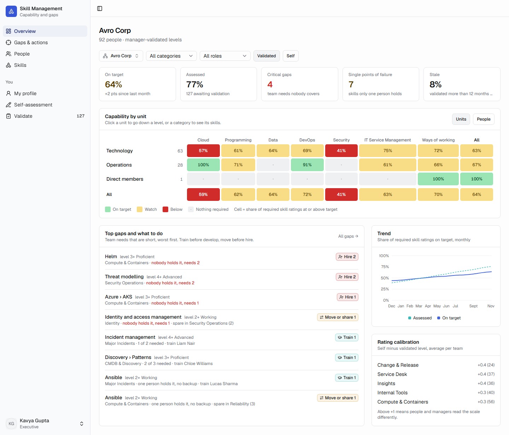

## Contents

- [What it does](#what-it-does)
- [How the numbers work](#how-the-numbers-work)
- [People from ServiceNow](#people-from-servicenow)
- [Sign-in and access](#sign-in-and-access)
- [Deploy with Docker](#deploy-with-docker)
- [Import and export](#import-and-export)
- [Develop](#develop)
- [Stack and supply chain](#stack-and-supply-chain)
- [Not built yet](#not-built-yet)

## What it does

### For executives and department heads

- **Overview** for any unit: five tiles (on target, assessed, critical gaps, single points of failure, stale), a **heatmap of units by skill category** coloured by the share of required skill ratings on target, **where teams are thin** (team needs with fewer people at the level than needed, worst first), a 12-month **trend**, and **rating calibration** by team.
- Click a unit to go down a level; click a category to see its skills. Every filter (unit, category, role, validated or self-assessed levels) lives in the URL, so any view can be bookmarked or shared.
- **Gaps**: team needs that are short, skills only one person holds, people below their targets, required skills nobody has rated, and training booked. It shows capability only, with no hiring or staffing advice. Every table exports to CSV.
- **Org chart**: who reports to whom, drawn as cards with a photo, name, designation, level (L0 is the top), headcount and how much of what everyone below them needs is on target. The top person is centred with their direct reports as columns below, and each column's own reports hang down a bracket. Blue cards lead a team; olive cards are team members. It shows three levels at a time: click a name to go inside, or press **i** for the important details (login, e-mail, manager, team, source, weakest skills below them, team needs that are short). When the columns do not fit the screen, the same levels are drawn as a vertical tree. A **List** view opens the whole tree to any level instead.

| Team heatmap | Gaps |
|---|---|
| 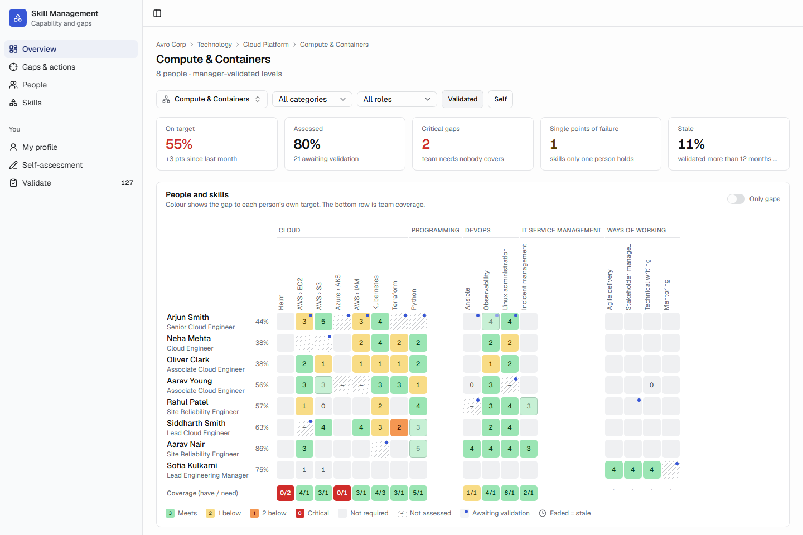 | 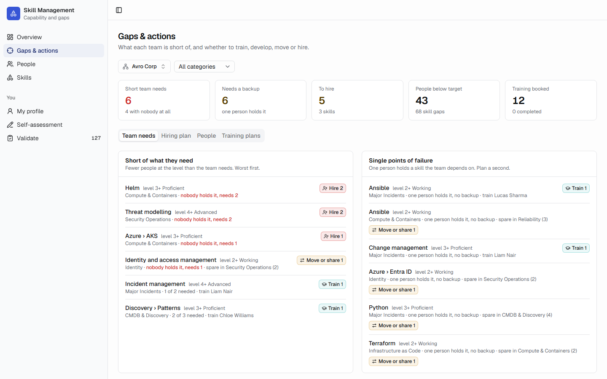 |

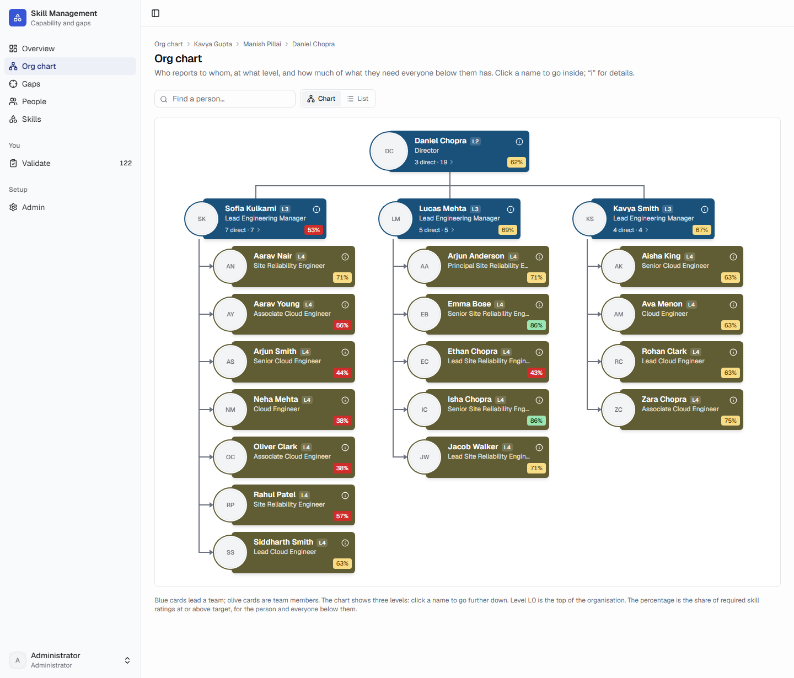

### For managers

- **People × skills heatmap** for their team: each cell is the person's validated level, coloured by the gap to *their own* target. A dot means awaiting validation, faded means stale, hatched means not assessed. The bottom row is **team coverage** (people at the level / people needed), flagging single points of failure.
- **Validate**: a queue of submitted self-assessments. Accept the level or change it, add evidence (required for Advanced and Expert), or send it back with a note. Bulk-accept per person.
- **My team**: say what the team needs, as in "2 people at Proficient in Kubernetes". The team need is on top of what the roles already expect. If the skill is not in the catalogue, add it there and then.
- **Per-person targets**: set a different required level for one person, with a reason, without touching the role standard.
- **Training plans** against a gap, with a link, due date and status.

| My team | Validate |
|---|---|
| 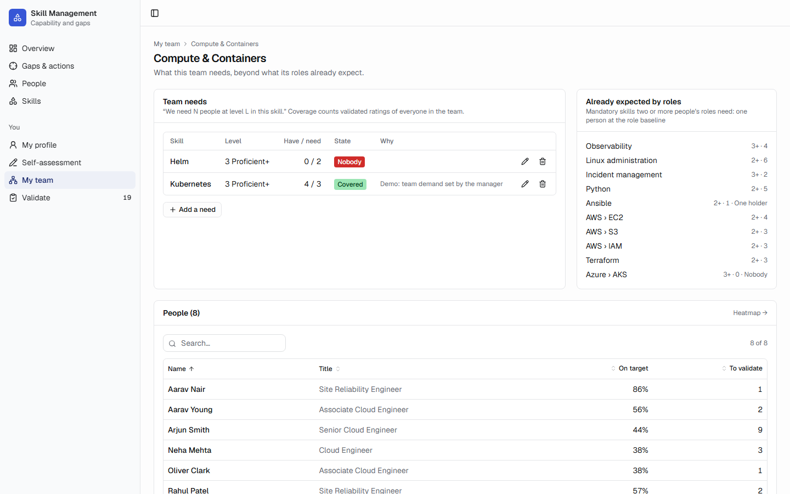 | 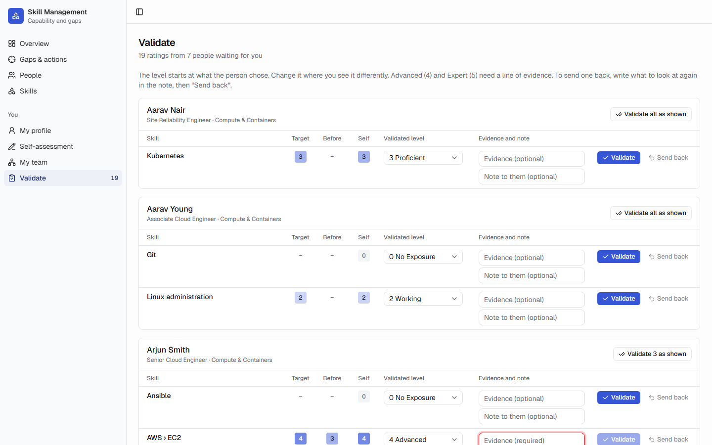 |

### For everyone

- **Self-assessment**: rate each skill 0–5 against plain-language level definitions. The person's role target is marked, and so is what their team needs. Add a comment, flag "I want to grow this", add skills they have beyond their role, or **suggest a skill** the catalogue lacks (an administrator approves it).
- **My profile**: role fit, self against validated against target by category (radar), what the next grade needs, training plans, and skills well above target.

| Self-assessment | Profile |
|---|---|
| 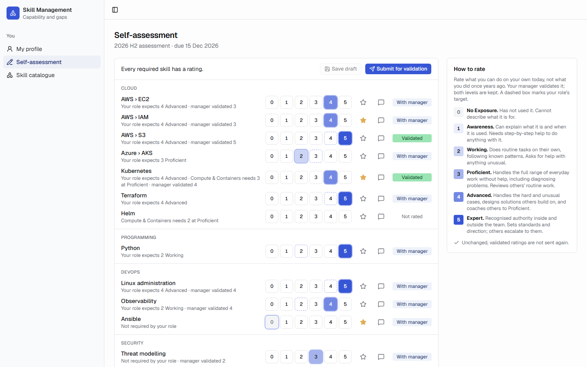 | 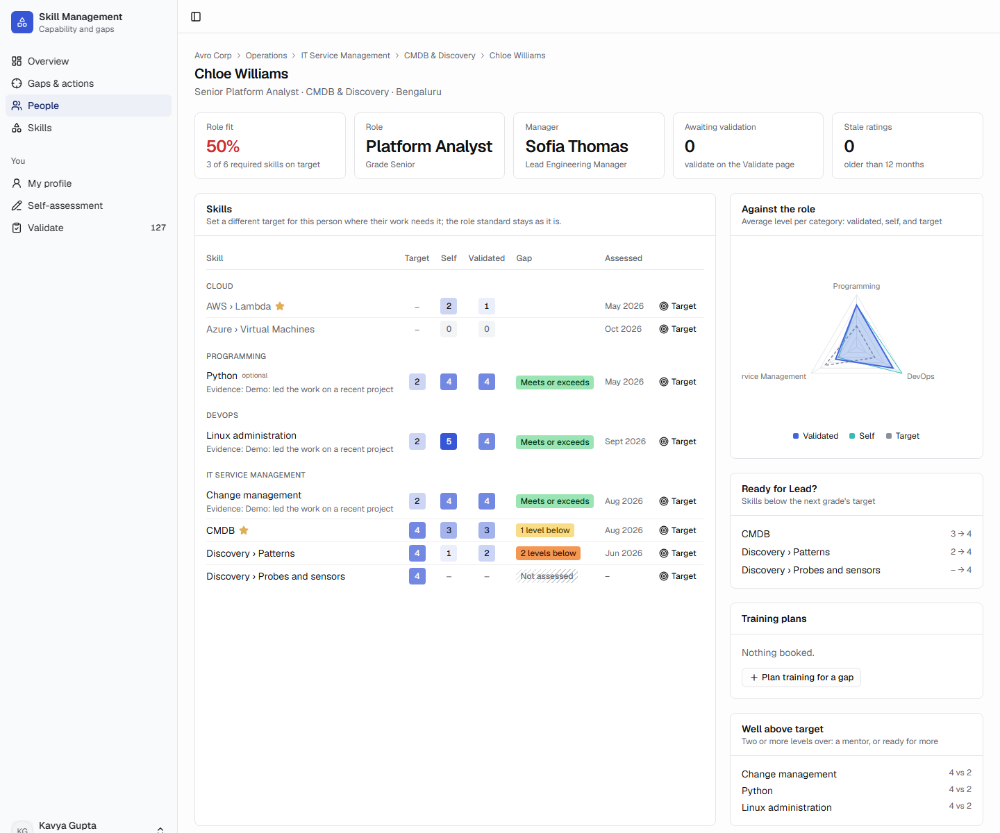 |

### For administrators

| Section | What |
|---|---|
| Organisation | The unit tree (company, division, department, team), unit managers, people (deactivate leavers; history stays) |
| Taxonomy | Category › skill › sub-skill (for example Cloud › AWS › EC2), aliases, status. Approve suggested skills, **merge duplicates** (ratings, targets and needs move across; the old name becomes an alias) |
| Roles & targets | Required level per role and skill, for all grades or per grade; mandatory or optional |
| Levels | The wording of the 0–5 scale |
| Cycles | Assessment rounds with a due date; one open at a time |
| Users & access | Accounts, access role, which person an account is, local passwords, disable |
| ServiceNow | The `sys_user` connection, the top-level user, which user types come in, field mapping, the sync schedule, **Test**, **Sync now** and the sync history; the photo URL |
| Single sign-on | SAML 2.0 identity provider from metadata or by hand; a **test sign-in pop-up** showing what the provider returns; which value identifies the person; **Activate** |
| Import & export | CSV in and out for everything below; dry run first; remove the demo data to go live |
| Settings | When a rating goes stale; colour thresholds |
| Audit log | Every change: who, what, when |

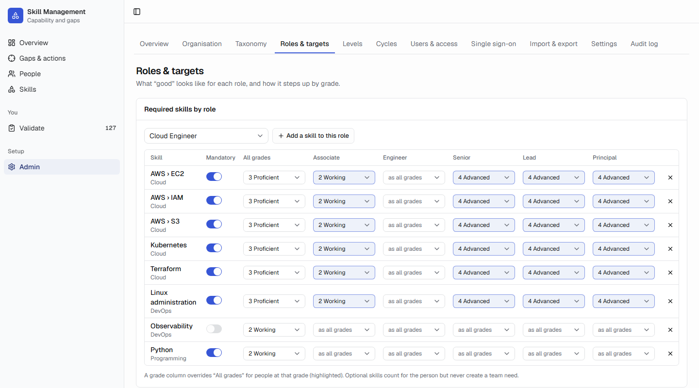

Every page is fluid, from a 320-pixel phone to a wide desktop: nothing makes the page scroll sideways. Wide grids (heatmaps, long tables) scroll inside their own card, and the validation queue turns each rating into its own block on a phone.

Dark mode follows the system and can be set per person:

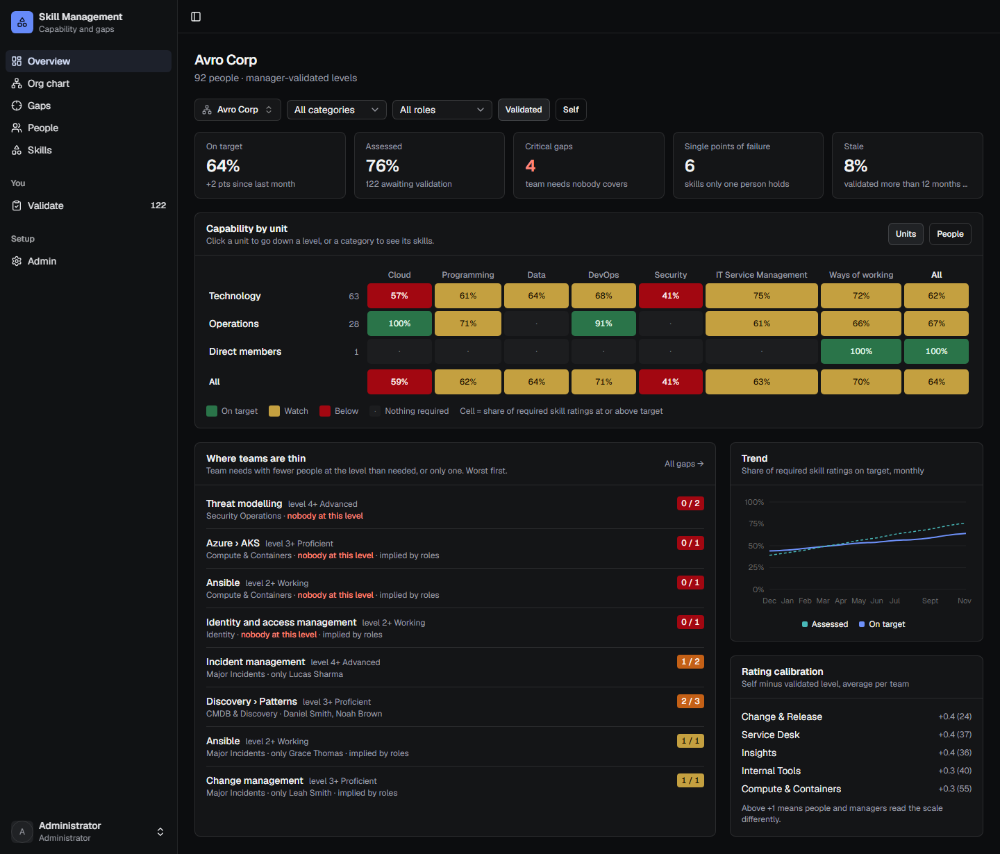

## How the numbers work

All of it is computed in one place (`src/lib/engine/engine.ts`), unit-tested, never stored.

- **Levels 0–5**: No Exposure, Awareness, Working, Proficient, Advanced, Expert. "Not assessed" is blank, never 0.
- **Self and validated are separate.** Management views use the manager-validated level by default; a toggle shows self-assessed levels instead.
- **Required level precedence**: a manager's per-person target, then the role's target for the person's grade, then the role's target for all grades. The source is shown on hover.
- **Only leaf skills are rated.** A skill with active sub-skills is a heading.
- **Gap = target − level.** 0 or less meets the target; 1 is minor; 2 is significant. 3 or more is critical, and so is a target of Proficient or higher held at Awareness or below.
- **Roll-ups count pairs, never average levels.** "On target" is the share of (person, required skill) pairs at or above target, so a department's number is exactly the sum of its teams.
- **Team needs**: an explicit need (N people at level L), or one implied when two or more members' roles need a mandatory skill (one person at the role baseline). **Coverage** is the people at or above L. One holder is a single point of failure; none is a critical gap.
- **Short and single holders**: a need is short when fewer people hold the level than it asks for, worst first. The app reports capability only; deciding what to do about a gap is left to people.
- **Stale**: a validated rating older than the setting (12 months by default) shows faded; optionally it stops counting as on target.
- **Calibration**: the average of self minus validated per team. Above +1 means people and managers read the scale differently.

## People from ServiceNow

Admin › ServiceNow brings people in from the `sys_user` table, so names, e-mail, managers and designations are kept in one place.

1. **Connection**: the instance URL, an integration user and its password. The user needs read access to `sys_user`. The password is stored encrypted (AES-256-GCM, keyed from the app's own secret) and is never shown again; leave the box blank to keep it.
2. **Who comes in**: a **top-level user** by `user_name`. The sync walks down the manager field from that person, recursively, to everyone below them.
3. **Which kinds of user**: a **user type field** (`identity_type` by default; any field works) and the values to bring in. **Load values** lists the values in the table with counts, so service accounts are easy to leave out. People below a left-out record are still found, and report to the nearest person who came in. An **extra filter** (an encoded query, `active=true` by default) applies to every record below the top user.
4. **Fields**: login name (`user_name`), display name (`name`), e-mail, manager and designation (`title`), each mappable to another column. **Also keep** stores extra columns, for example `employee_number` for the photo URL.
5. **Test** runs the whole walk and shows who would come in, at what level, under which manager, and who the type filter leaves out. Nothing is saved.
6. **Sync now**, or a **schedule** every N hours. Each run is listed in the sync history with what it created, updated and deactivated, or why it failed. A failed run changes nothing.

What a sync does:

- Matches an existing person by ServiceNow `sys_id`, then e-mail, then login name, so people added by hand or by CSV are adopted rather than duplicated.
- Sets each person's manager from ServiceNow. People who leave the result are **deactivated, never deleted**, so their history stays.
- **Builds teams from the manager chain** (switchable): every manager leads a team named after them, and everyone else sits in their manager's team. Turn it off to keep units managed by hand or by CSV.
- **Only people who came in this way, or were added by an administrator, can sign in with single sign-on.**

**Photos** (Admin › ServiceNow › Photos): a URL with placeholders, such as `https://photos.example.com/{user_name}.jpg`. `{user_name}`, `{email}`, `{sys_id}` and any kept column are filled from each person. Empty means initials.

The running app needs to reach the instance. Behind a proxy, set `RUNTIME_HTTPS_PROXY` in the env file.

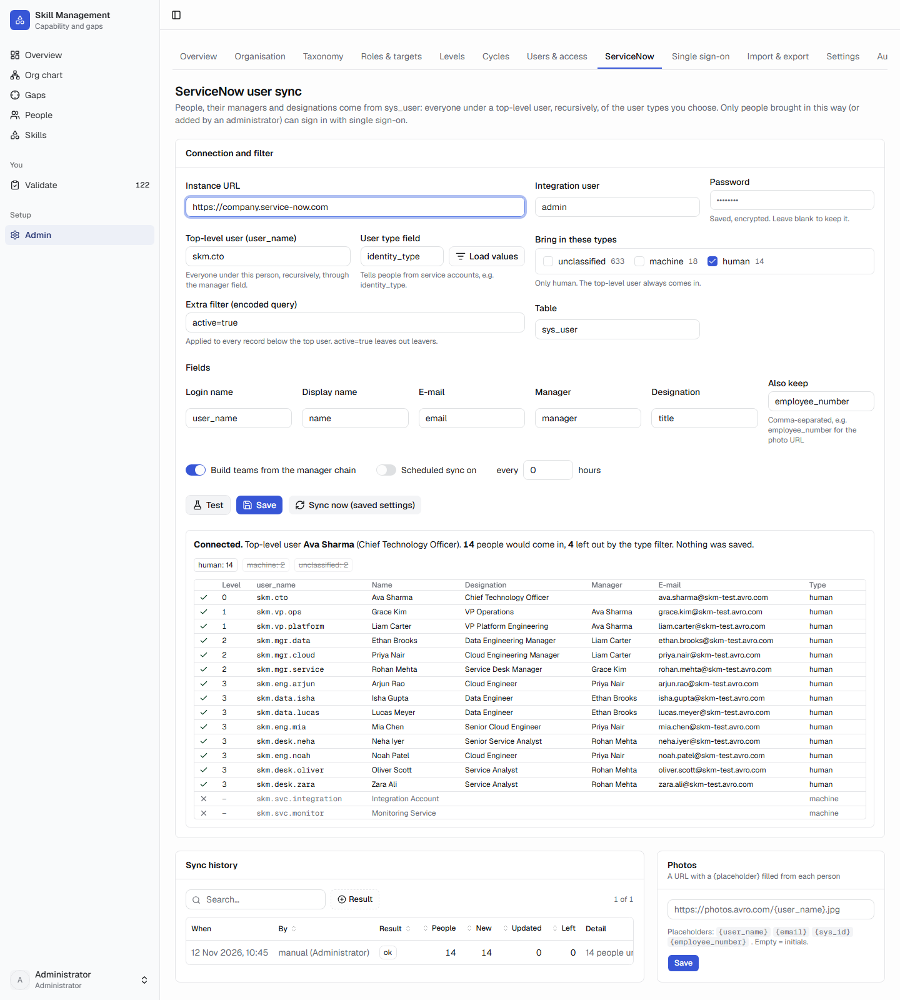

## Sign-in and access

- **First start** creates `admin` / `admin` for setup. It is not forced to change its password; set `FORCE_PASSWORD_CHANGE=true` to require that (any new password needs 10+ characters).
- **Once single sign-on works, disable `admin`.** Sign in with SSO, have `admin` give your SSO account **Administrator** in Admin › Users & access, then sign in as yourself and **Disable** `admin` there. Nobody can disable their own account, so the last signed-in administrator can never lock everyone out. Re-enable it the same way if SSO ever breaks.
- **Access follows who people are.** Anyone who manages a unit or has direct reports is a **manager** automatically, and sees, validates and sets targets for their people. Everyone else is a **team member**: their own profile and self-assessment. **Executive** (read everything) and **Administrator** are assigned in Admin › Users & access.
- **Local accounts** can be added for people without SSO; they set their own password at first sign-in.
- **SAML 2.0 single sign-on** (Admin › Single sign-on): paste the identity provider's metadata XML, or enter its entity ID, sign-in URL and signing certificate. Give the identity team the values on the same page:

  | | |
  |---|---|
  | Entity ID (Audience) | `${APP_URL}/api/auth/sso/saml2/sp/metadata?providerId=<id>` |
  | ACS URL (HTTP-POST) | `${APP_URL}/api/auth/sso/saml2/sp/acs/<id>` |
  | Name ID | e-mail address |
  | Attributes | `email` (and `displayName`); other names are configurable |
  | Signing | assertions must be signed |

  Then, on the same page:

  1. **Test sign-in** opens a pop-up that signs in at the identity provider. While SSO is not active, nobody is signed in: the attempt is captured and the page lists every value the provider returned (name ID and attributes).
  2. **Identify the person**: choose which returned value must equal which field of a person, e-mail or ServiceNow `user_name`. **Check** shows who it would match.
  3. **Activate single sign-on**. It refuses until a test sign-in exists and its value matches an active person. Only then does the sign-in page show the SSO button.

  Once active, a person whose value matches an active person signs in and is linked to that record. Everyone else is refused with a clear message and the attempt is listed on the page. Then disable the local `admin` (above).

  `test/saml.test.ts` runs the whole flow against a made-up identity provider. Before activation every sign-in is a captured test. After it, a synced person signs in and a stranger is refused. A tampered assertion, or one signed by another key, is refused.

  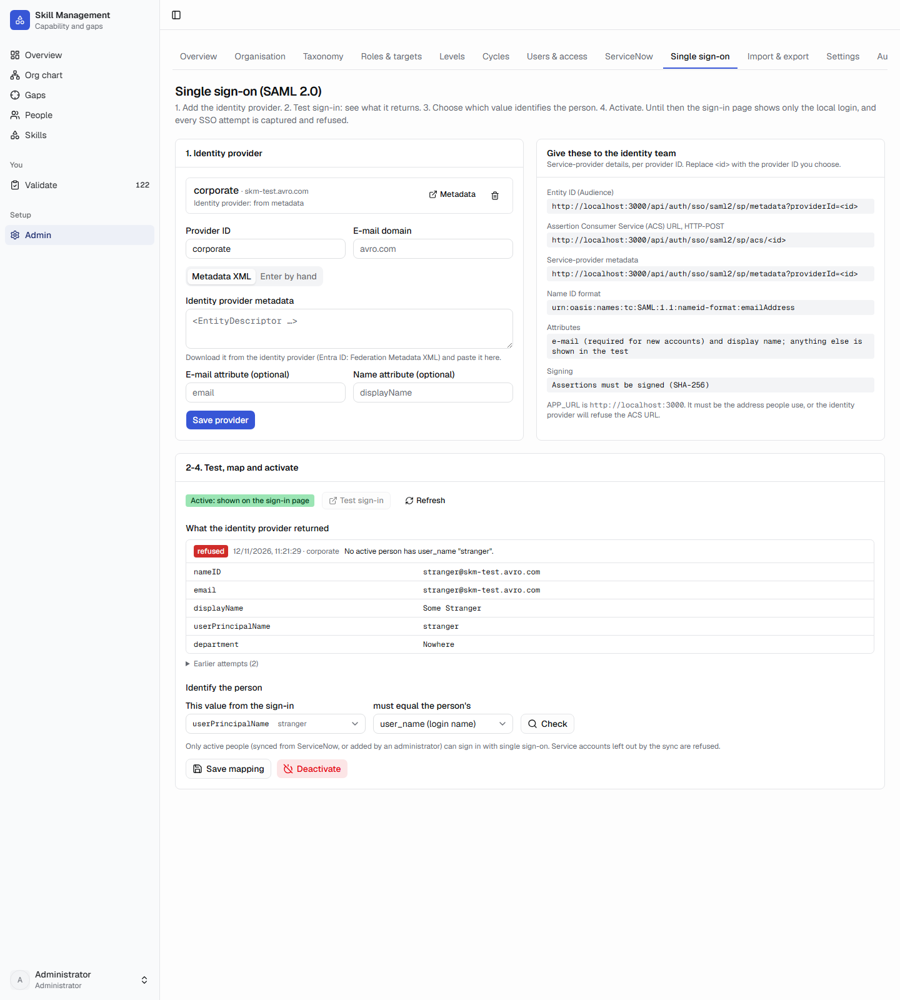

## Deploy with Docker

One command per place, each with a committed env file that holds **no secrets**:

```bash
docker compose --env-file home.env up --build -d
```

```bash
docker compose --env-file work.env up --build -d
```

- `work.env` holds **placeholders on avro.com** for the image registry prefix, apt mirror, npm registry and proxy. Replace them on the work machine with the real values, and never commit those. `home.env` uses the public registries with no proxy.
- A token for a private npm registry is given for one command only: `NPM_TOKEN=... docker compose --env-file work.env up --build -d`.
- Corporate CA certificates for a TLS-inspecting proxy go in `certs/*.crt` (gitignored) on the build machine.
- Two containers, host networking. **PostgreSQL 17** listens on `127.0.0.1:${DB_PORT}` only; the **app** listens on `${APP_PORT}` (8080). Put TLS in front of the app (the company load balancer, or a reverse proxy) and set `APP_URL` to the https address people type: secure cookies and SAML depend on it.
- **Data** lives in `${DATA_DIR}`. `pgdata/` holds the database (bind mount). `secrets/` holds the database password and the session-signing secret, generated on the first start and readable only by the app's user. At work `DATA_DIR` sits outside the code folder, so copying a new version over the code never touches the data.
- **First start** migrates the database and creates `admin`. With `SEED_DEMO=true` it also loads the demo organisation (Avro Corp, made-up people), once. Sign in as `exec`, `manager` or `employee` with password `demo` to see each audience. Remove the demo in Admin › Import & export when going live.
- **Upgrade**: copy the new code, run the same command again. Migrations apply on start.
- **Backup**:

  ```bash
  docker exec skill-management-db-1 pg_dump -U skills -d skills -Fc > skills-$(date +%F).dump
  ```

| Key | Meaning |
|---|---|
| `IMAGE_REGISTRY`, `APT_MIRROR`, `NPM_REGISTRY`, `HTTP_PROXY`, `HTTPS_PROXY`, `NO_PROXY` | Where the build downloads from. Empty means off. |
| `RUNTIME_HTTPS_PROXY` | The proxy the running app uses to reach ServiceNow. Empty means none. `NO_PROXY` applies too. |
| `APP_PORT`, `APP_BIND`, `APP_URL`, `TRUSTED_ORIGINS` | How people reach it |
| `DB_PORT` | PostgreSQL's loopback port |
| `SEED_DEMO`, `FORCE_PASSWORD_CHANGE`, `ORG_NAME` | First start |
| `DATA_DIR`, `TZ` | Where the data lives; time zone |

## Import and export

Admin › Import & export, or `GET /api/export/<kind>` as an administrator. CSV with names, paths (`Avro Corp > Technology`, `AWS > EC2`) and e-mail addresses, never internal ids. Every export imports back unchanged (`test/transfer.test.ts` proves it end to end). Bad rows are skipped and reported by line; **Check (dry run)** changes nothing.

Load in this order the first time: `skills`, `grades`, `roles`, `role-skills`, `units`, `people`, `person-targets`, `team-needs`, `ratings`, `training-plans`.

## Develop

```bash
npm ci
```

```bash
npm run dev
```

Without `DATABASE_URL` the app uses an embedded PostgreSQL (PGlite) in `.data/`, so development needs no database server and no Docker. Put `SEED_DEMO=true` in `.env.local` for the demo organisation.

```bash
npm test
```

```bash
npm run typecheck
```

| Test | What it holds |
|---|---|
| `test/engine.test.ts` | Every rule in *How the numbers work* |
| `test/db.test.ts` | Migrations, seeding (idempotent), `admin`/`admin`, the demo story |
| `test/transfer.test.ts` | CSV round trip of everything, dry run, line-numbered errors |
| `test/saml.test.ts` | SAML sign-in end to end: test capture before activation, synced people only after it, tampered and wrongly signed assertions refused |
| `test/directory.test.ts` | The ServiceNow sync against a stand-in instance: the walk, the type filter, matching, managers, teams from the chain, deactivation, failed runs, the sealed password, photo URLs |
| `test/servicenow.live.test.ts` | The same walk against a real instance; skipped unless `SN_LIVE_INSTANCE`, `SN_LIVE_USER`, `SN_LIVE_PASS` and `SN_LIVE_ROOT` are set |
| `test/deployment.test.ts` | The deployment rules: pins, the 72-hour gate, no site locations baked in, no secrets in env files, anchored ignores |

Schema changes: edit `src/db/schema.ts`, then `npm run db:generate` and commit the new file in `drizzle/`.

## Stack and supply chain

Next.js 16 (App Router, standalone output) · TypeScript · Tailwind CSS 4 · shadcn/ui · TanStack Table · Recharts · better-auth with its SAML plugin · Drizzle ORM · PostgreSQL 17 (PGlite in development).

- **Nothing younger than 72 hours is installed.** Dependency versions are exact. `scripts/check-release-age.cjs` checks every lockfile entry against `deps-publish-times.json` (committed; refresh with `npm run deps:age`), offline, inside the Docker build after `npm ci`.
- **Images are pinned by digest** (`image-pins.json` records when each was pushed). A digest is the same behind a registry mirror.
- The build reaches nothing on the internet beyond the package registry: telemetry is off, and the font is self-hosted.
- The runtime image is Ubuntu 24.04 running as an unprivileged user with a read-only root filesystem. It carries no proxy, registry or token. The health check uses curl, not a language runtime.

```
src/lib/engine/engine.ts   every number: targets, gaps, roll-ups, coverage
src/lib/directory/         ServiceNow client, the sync, its settings and schedule
src/lib/sso-gate.ts        who may sign in with SSO, test capture, linking
src/db/                    schema, migrations, first-start seed, demo organisation
src/lib/transfer.ts        CSV import and export
src/lib/auth.ts, saml.ts   local sign-in and SAML single sign-on
src/app/(app)/             the pages; src/app/actions/ the server actions
deploy/db-entrypoint.sh    generates the secrets on the first start
```

## Not built yet

Picked up from the design notes in `IDEAS.md`; none needed for the requirements so far.

- Certifications with expiry dates and reminders
- E-mail digests for managers (pending validations, new critical gaps)
- Peer endorsements as a third, labelled value
- SCIM provisioning from the identity provider (people come from ServiceNow, CSV or an administrator)
- Organisation data beyond the manager chain (departments or cost centres from another source)
- SAML single logout (signing out ends the app session only)
